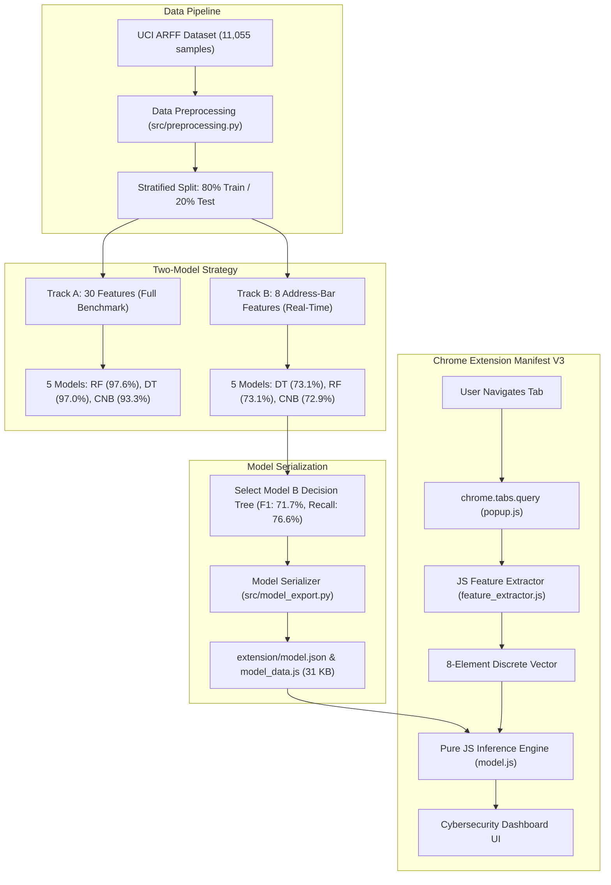
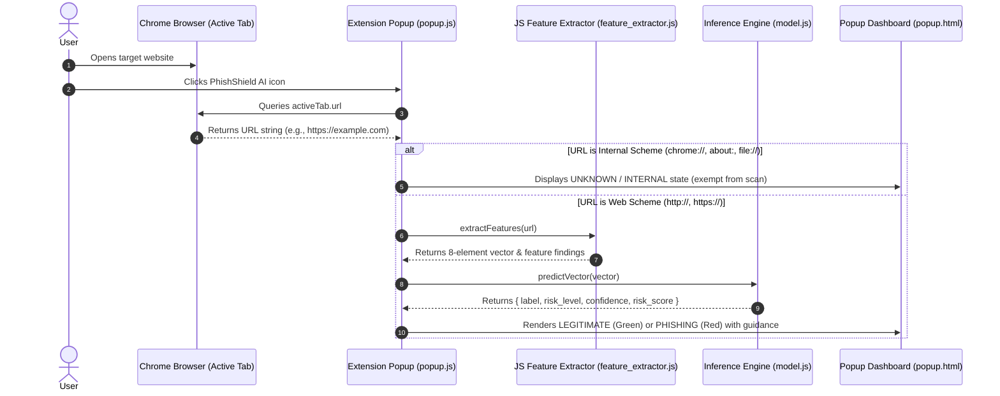

# System Architecture Documentation
## AI-Based Phishing Website Detection System

This document describes the architectural layout, data pipelines, model deployment, and browser runtime execution flow.

---

## 1. End-to-End System Pipeline

---

## 2. Real-Time Browser URL Detection Pipeline

---

## 3. Directory and Component Mapping

| Component | Files | Primary Responsibility |
|---|---|---|
| **Data Engineering** | `src/preprocessing.py`, `dataset/download_dataset.py` | Dataset ingestion, duplicate analysis, stratified splitting |
| **Feature Extraction** | `src/feature_extractor.py`, `extension/feature_extractor.js` | 8-feature URL extraction with 100% parity |
| **Model Training** | `src/train_models.py`, `src/models_common.py` | 5-fold CV hyperparameter tuning across 5 algorithms |
| **Model Evaluation** | `src/evaluate_models.py` | Metrics calculation, confusion matrices, ROC curves |
| **Deployment Engine** | `src/model_export.py`, `extension/model.js` | Tree serialization to JSON & pure JS browser execution |
| **Browser Extension** | `extension/manifest.json`, `popup.html`, `popup.css`, `popup.js`, `background.js` | Manifest V3 cybersecurity dashboard |
| **Quality Assurance** | `tests/test_feature_extractor.py`, `test_model.py`, `test_prediction_parity.py` | Automated testing & Python-JS parity verification |
