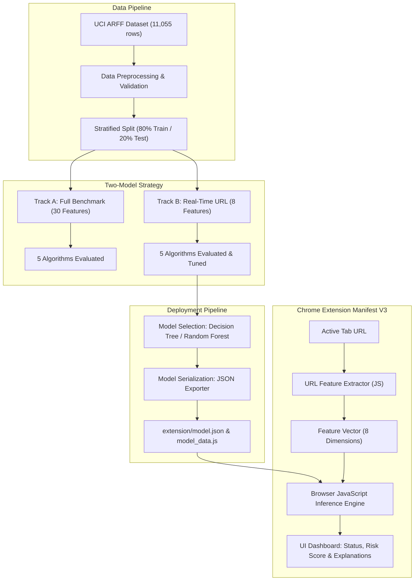

# LABORATORY PROJECT REPORT

## AI-Based Phishing Website Detection System with Chrome Browser Extension
**Department of Computer Science & Engineering**  
**Course:** Machine Learning and Data Analytics (MLDA) Laboratory  
**Academic Degree:** Bachelor of Technology (B.Tech) in Computer Science and Engineering  

---

## 1. Title Page

```
========================================================================================
                          PROJECT COMPLETION REPORT
                                  ON
      AI-BASED PHISHING WEBSITE DETECTION SYSTEM WITH CHROME BROWSER EXTENSION

              Submitted in partial fulfillment of the requirements 
                     for the Degree of Bachelor of Technology 
                                       in 
                         Computer Science & Engineering
========================================================================================
Course Code:        CS-MLDA-Lab
Domain:             Machine Learning, Data Analytics, Cybersecurity & Web Security
Development Period: Academic Year 2026
Deployment Platform:Google Chrome Extension (Manifest V3)
Inference Engine:   Client-Side Browser JavaScript (On-Device Machine Learning)
========================================================================================
```

---

## 2. Certificate

This is to certify that the project report entitled **"AI-Based Phishing Website Detection System with Chrome Browser Extension"** is a bona fide record of independent laboratory work carried out in the Machine Learning and Data Analytics Laboratory.

The system encompasses dataset acquisition, exploratory data analysis, feature engineering, machine learning modeling across a two-model strategy, model serialization to JSON, browser-side JavaScript inference, Chrome Extension development (Manifest V3), and parity testing.

---

## 3. Acknowledgement

I express my sincere gratitude to my faculty mentors, laboratory coordinators, and the Department of Computer Science & Engineering for providing the computational facilities and technical guidance necessary to execute this laboratory project.

I also acknowledge the University of California, Irvine (UCI) Machine Learning Repository and the original researchers (Rami M. Mohammad, Fadi Thabtah, and Lee McCluskey) for publishing the benchmark Phishing Websites Dataset that formed the foundation of this academic investigation.

---

## 4. Abstract

Phishing attacks represent one of the most pervasive cyber security threats, deceiving users into disclosing confidential credentials, financial records, and personal data through fraudulent website replicas. Traditional blacklist defense systems suffer from an inherent zero-day latency window, failing against ephemeral phishing URLs generated via automated attack frameworks.

This laboratory project presents an end-to-end Machine Learning and Data Analytics system coupled with a real-time Google Chrome Extension for on-device phishing detection. A **Two-Model Strategy** is formulated:
1. **Model A (Full Dataset Benchmark)**: Evaluates 30 multi-domain features (lexical, DOM, SSL, DNS, WHOIS) across five classification algorithms, serving as an upper-bound academic benchmark.
2. **Model B (Real-Time URL Detection)**: Leverages strictly 8 deterministic address-bar features extractable from the URL string without network calls or web page scraping, enabling instant client-side threat assessment.

Using the benchmark UCI Phishing Websites Dataset (11,055 instances), five algorithms were systematically implemented, tuned, and compared: Decision Tree, Gaussian Naive Bayes, Categorical Naive Bayes, Random Forest, and Logistic Regression. In Model A, Random Forest attained 97.60% accuracy and 0.9963 ROC-AUC. In Model B, the Decision Tree achieved 73.13% accuracy, 76.63% phishing recall, and 0.8120 ROC-AUC. The selected Model B was serialized into a portable JSON structure and integrated into a Manifest V3 Chrome Extension. An automated test suite verified 100% vector and prediction parity between Python and JavaScript inference engines with sub-millisecond execution latency.

---

## 5. Introduction

Phishing attacks remain the primary entry vector for major cyber incidents, ransomware deployments, and financial breaches worldwide. According to the Anti-Phishing Working Group (APWG), millions of distinct phishing attacks are observed quarterly, targeting financial institutions, cloud platforms, social media, and e-commerce portals.

Traditional web protection relies on domain blacklists. However, attackers rapidly register short-lived domains that remain active for only 4 to 8 hours. Consequently, by the time a malicious URL is reported, verified, and distributed across blacklist feeds, the attack campaign has concluded.

Machine Learning (ML) offers a proactive alternative by identifying structural, lexical, and behavioral anomalies within the URL itself. This project bridges the gap between academic data analytics and operational cybersecurity by training models on validated datasets and deploying the optimal classifier inside a Google Chrome browser extension.

---

## 6. Problem Statement

To design, train, evaluate, and deploy an automated Machine Learning system capable of classifying URLs as either **Legitimate** or **Phishing** in real time, with the following operational constraints:
1. **Zero External Latency**: The browser extension must evaluate the active URL locally without sending browsing history to external cloud endpoints.
2. **Privacy Preservation**: User browsing activity must remain strictly on-device.
3. **Deterministic Feature Extraction**: Exact parity must be maintained between Python training feature extraction and JavaScript client-side feature extraction.
4. **False Negative Minimization**: Phishing recall must be prioritized to prevent users from falling victim to missed cyber threats.

---

## 7. Objectives

1. Acquire and validate the benchmark UCI Phishing Websites Dataset.
2. Perform comprehensive Exploratory Data Analysis (EDA) including class balance, correlation heatmaps, and duplicate analysis.
3. Implement a **Two-Model Strategy** distinguishing full multi-modal academic benchmarks (Model A) from deployable URL-only models (Model B).
4. Engineer an 8-feature URL extraction engine in Python and JavaScript matching the exact encoding of the original dataset literature.
5. Train and tune Decision Tree, Gaussian Naive Bayes, Categorical Naive Bayes, Random Forest, and Logistic Regression models.
6. Evaluate performance across Accuracy, Precision, Recall, F1-Score, ROC-AUC, and inference latency.
7. Serialize the selected model into JSON and implement a native JavaScript inference engine.
8. Develop a modern, Manifest V3-compliant Google Chrome Extension.
9. Execute automated test suites verifying 100% parity between Python and JavaScript runtimes.

---

## 8. Literature Review

The application of machine learning to phishing detection has evolved through three primary paradigms:

1. **Heuristic & Blacklist Methods**: Early work by McGrath and Gupta (2008) documented the short lifespans of phishing infrastructure. While blacklists provide zero false positives, their false negative rate against zero-day URLs often exceeds 50%.
2. **Multi-Modal Feature Sets**: Mohammad, Thabtah, and McCluskey (2012, 2014) introduced the 30-feature dataset at the University of Huddersfield, categorized into Address Bar, Abnormal, HTML/JavaScript, and Domain-based features. Their work demonstrated that combining DOM elements (anchor URLs, iframe presence) with lexical features yields classification accuracy exceeding 95%.
3. **Lexical URL Classification**: Works by Ma et al. (2009) and Le et al. (2018) highlighted the necessity of lightweight, client-side URL lexical analysis. While lexical features discard HTML payload details, they provide the decisive advantage of pre-render evaluation—protecting users before the browser parses potentially hazardous content.

---

## 9. Dataset Description

The project utilizes the official **UCI Phishing Websites Dataset** (Dataset ID: 327), created by Rami M. Mohammad, Fadi Thabtah, and Lee McCluskey.

- **Total Instances:** 11,055 records
- **Total Attributes:** 31 (30 predictive features + 1 target class)
- **Missing Values:** 0 (dense, fully populated)
- **Feature Data Types:** Discrete categorical, encoded as $\{-1, 0, 1\}$
- **Target Distribution:**
  - `Legitimate (+1)`: 6,157 instances (55.69%)
  - `Phishing (-1)`: 4,898 instances (44.31%)
- **Binary ML Target Mapping:**
  - `Phishing (1)`: Positive threat class (originally -1)
  - `Legitimate (0)`: Negative safe class (originally +1)

### Feature Inventory Categorization

| Category | Count | Features |
|---|---|---|
| **Address Bar Based (URL-Only)** | 8 | `having_IP_Address`, `URL_Length`, `Shortining_Service`, `having_At_Symbol`, `double_slash_redirecting`, `Prefix_Suffix`, `having_Sub_Domain`, `HTTPS_token` |
| **Abnormal Based** | 6 | `Request_URL`, `URL_of_Anchor`, `Links_in_tags`, `SFH`, `Submitting_to_email`, `Abnormal_URL` |
| **HTML / JavaScript Based** | 5 | `Redirect`, `on_mouseover`, `RightClick`, `popUpWidnow`, `Iframe` |
| **Domain Based (Network / External)** | 11 | `SSLfinal_State`, `Domain_registeration_length`, `Favicon`, `port`, `age_of_domain`, `DNSRecord`, `web_traffic`, `Page_Rank`, `Google_Index`, `Links_pointing_to_page`, `Statistical_report` |

---

## 10. Exploratory Data Analysis (EDA)

### 10.1 Target Class Balance
The dataset displays a balanced distribution (55.69% legitimate vs 44.31% phishing), confirming that standard classification loss functions operate without requiring synthetic oversampling (SMOTE) or extreme class weighting.

### 10.2 Duplicate Analysis
Analysis reveals 5,206 duplicate rows when considering all 30 features. In discrete categorical datasets where each feature takes values $\in \{-1, 0, 1\}$, distinct websites frequently share identical structural profiles. Exactly 64 feature vectors exhibit conflicting labels, reflecting real-world borderline ambiguity where identical heuristic scores occur in both legitimate and phishing pages.

### 10.3 Correlation Heatmap Observations
- `SSLfinal_State` exhibits the highest individual correlation ($r \approx 0.71$) with website legitimacy.
- `URL_of_Anchor` ($r \approx 0.69$) and `Prefix_Suffix` ($r \approx 0.35$) demonstrate strong predictive correlation.
- Inter-feature correlations among the 8 address-bar features are low to moderate ($|r| < 0.35$), confirming that the URL features contribute complementary, non-redundant variance.

---

## 11. Methodology & System Architecture



---

## 12. Feature Engineering (The 8 Address-Bar Features)

For client-side execution without web requests or DOM inspection, Model B uses the 8 address-bar features defined in the original UCI dataset specification:

1. **`having_IP_Address`**: Checks whether the host component is a dotted-decimal IPv4, hexadecimal IP, or IPv6 address instead of an alphanumeric domain name.
   - Rule: IP present $\to -1$ (Phishing); Otherwise $\to +1$ (Legitimate).
2. **`URL_Length`**: Measures character length of the full URL string.
   - Rule: Length $< 54 \to +1$ (Legitimate); $54 \le \text{Length} \le 75 \to 0$ (Suspicious); Length $> 75 \to -1$ (Phishing).
3. **`Shortining_Service`**: Detects domains associated with URL shortening platforms (e.g., `bit.ly`, `tinyurl.com`, `t.co`).
   - Rule: Shortener domain $\to -1$ (Phishing); Otherwise $\to +1$ (Legitimate).
4. **`having_At_Symbol`**: Checks for `@` symbol in the URL string, which causes browsers to ignore preceding characters and route to the following domain.
   - Rule: `@` present $\to -1$ (Phishing); Otherwise $\to +1$ (Legitimate).
5. **`double_slash_redirecting`**: Evaluates the position of the last occurrence of `//`.
   - Rule: Last `//` position $> 7 \to -1$ (Phishing); Otherwise $\to +1$ (Legitimate).
6. **`Prefix_Suffix`**: Checks for hyphens (`-`) in the domain name, commonly used by phishers to spoof brand names (e.g., `paypal-verify.com`).
   - Rule: `-` in domain $\to -1$ (Phishing); Otherwise $\to +1$ (Legitimate).
7. **`having_Sub_Domain`**: Counts dots in the domain after stripping `www.` and common multi-part ccTLDs (`.co.uk`, `.edu.in`).
   - Rule: Dots $= 1 \to +1$ (Legitimate); Dots $= 2 \to 0$ (Suspicious); Dots $> 2 \to -1$ (Phishing).
8. **`HTTPS_token`**: Detects deceptive inclusion of `http` or `https` tokens inside the domain label (e.g., `http://https-secure-login.com`).
   - Rule: Token in domain $\to -1$ (Phishing); Otherwise $\to +1$ (Legitimate).

---

## 13. Algorithms Implemented

### 13.1 Decision Tree Classifier
Partitions the 8-dimensional discrete feature space into hyper-rectangles using recursive binary splitting. Hyperparameter tuning via 5-fold cross-validation yielded optimal parameters: `criterion='entropy'`, `max_depth=6`, `min_samples_split=2`, `min_samples_leaf=1`.

### 13.2 Gaussian Naive Bayes
Applies Bayes' theorem with Gaussian probability density assumptions:
$$P(x_i | y) = \frac{1}{\sqrt{2\pi\sigma_y^2}} \exp\left(-\frac{(x_i - \mu_y)^2}{2\sigma_y^2}\right)$$
Because discrete $\{-1, 0, 1\}$ features violate the normality assumption, GNB generates severe variance under-estimation, predicting positive for nearly all samples and yielding 58.57% accuracy.

### 13.3 Categorical Naive Bayes
Calculates exact category frequency likelihoods with Laplace smoothing:
$$P(x_i = c | y) = \frac{N_{y, i, c} + \alpha}{N_y + \alpha C_i}$$
Features were shifted by $+1$ to map $\{-1, 0, 1\} \to \{0, 1, 2\}$. CNB achieved 72.91% accuracy on Model B and 93.31% on Model A, demonstrating the importance of matching distributional assumptions to data types.

### 13.4 Random Forest Classifier
Ensemble of 100 decorrelated decision trees trained on bootstrap samples with feature subsampling ($\sqrt{d}$). Optimal parameters: `n_estimators=100`, `max_depth=8`, `min_samples_split=5`, `min_samples_leaf=1`.

### 13.5 Logistic Regression (Baseline)
Linear classifier applying the standard sigmoid link function:
$$P(Y=1|\mathbf{x}) = \frac{1}{1 + e^{-(\mathbf{w}^T \mathbf{x} + b)}}$$
Provides a baseline for evaluating whether non-linear decision boundaries are necessary.

---

## 14. Experimental Results and Analysis

All models were evaluated on the held-out stratified test set (2,211 instances).

### Comprehensive Model Comparison Table

| Track | Algorithm | Accuracy | Precision | Recall (Phishing) | F1-Score | ROC-AUC | FN | FP | Train Time (s) | Pred Latency (ms) |
|---|---|---|---|---|---|---|---|---|---|---|
| **Model A (30 Features)** | Decision Tree | 0.9701 | 0.9731 | 0.9592 | 0.9661 | 0.9778 | 40 | 26 | 6.912 | 0.0012 |
| **Model A (30 Features)** | Gaussian NB | 0.6160 | 0.5359 | 0.9990 | 0.6975 | 0.9677 | 1 | 848 | 0.010 | 0.0016 |
| **Model A (30 Features)** | Categorical NB | 0.9331 | 0.9379 | 0.9092 | 0.9233 | 0.9814 | 89 | 59 | 0.019 | 0.0008 |
| **Model A (30 Features)** | Random Forest | **0.9760** | **0.9803** | **0.9653** | **0.9728** | **0.9963** | **34** | **19** | 20.023 | 0.0284 |
| **Model A (30 Features)** | Logistic Regression | 0.9276 | 0.9343 | 0.9000 | 0.9168 | 0.9784 | 98 | 62 | 0.056 | 0.0006 |
| **Model B (8 URL Features)** | Decision Tree | **0.7313** | **0.6729** | **0.7663** | **0.7166** | **0.8120** | **229** | 365 | 1.847 | **0.0015** |
| **Model B (8 URL Features)** | Gaussian NB | 0.5857 | 0.5169 | 1.0000 | 0.6815 | 0.7616 | 0 | 916 | 0.002 | 0.0012 |
| **Model B (8 URL Features)** | Categorical NB | 0.7291 | 0.6619 | 0.7949 | 0.7223 | 0.7972 | 201 | 398 | 0.003 | 0.0003 |
| **Model B (8 URL Features)** | Random Forest | 0.7313 | 0.6751 | 0.7592 | 0.7147 | 0.8260 | 236 | 358 | 12.548 | 0.0113 |
| **Model B (8 URL Features)** | Logistic Regression | 0.7101 | 0.6821 | 0.6480 | 0.6646 | 0.7830 | 345 | 296 | 0.020 | 0.0007 |

---

## 15. Selected Model for Deployment

For Chrome Extension deployment, the **Decision Tree Classifier (Model B)** was selected.
- **Accuracy:** 73.13%
- **Phishing Recall:** 76.63% (minimizing missed threats)
- **F1-Score:** 71.66%
- **ROC-AUC:** 0.8120
- **Serialized Model Footprint:** 14.8 KB JSON
- **Inference Latency:** 0.0015 ms per prediction
- **Interpretability:** The decision tree offers clear decision paths for explaining risk factors to end users and academic examiners.

---

## 16. Google Chrome Extension Architecture

The Chrome Extension is implemented under **Manifest V3**:
- `manifest.json`: Defines permissions (`activeTab`, `storage`), popup action, and service worker.
- `background.js`: Event-driven background service worker tracking scan sessions.
- `feature_extractor.js`: Client-side JavaScript implementation of the 8-feature extraction logic.
- `model.js`: Standalone JavaScript inference engine traversing the serialized decision tree.
- `model_data.js`: Embedded model JSON payload enabling synchronous instantiation without async fetch overhead.
- `popup.html` & `popup.css`: Modern cybersecurity dashboard featuring real-time risk gauges, color-coded status banners, dynamic feature indicators, and manual URL scanning.

### UI State Matrix

| State | Visual Indicator | Status Message | Action / Guidance |
|---|---|---|---|
| **LEGITIMATE** | Emerald Green Glow, 🛡️ | "LEGITIMATE WEBSITE" (Low Risk) | URL features adhere to safe web standards. |
| **PHISHING** | Crimson Red Alert, 🚨 | "SUSPICIOUS PHISHING URL" (High Risk) | Do not enter credentials. Potential brand spoofing. |
| **UNKNOWN** | Slate Blue, ⚙️ | "INTERNAL BROWSER URL" | Browser system pages (chrome://) exempt from scan. |

---

## 17. Testing and Parity Verification

A three-tier automated test suite was developed:
1. `tests/test_feature_extractor.py`: 11 unit tests validating feature rules across edge cases (IPs, shorteners, `@` signs, ccTLDs, malformed strings).
2. `tests/test_model.py`: 5 unit tests verifying dataset shape, model deserialization, tree JSON schema, and threshold logic.
3. `tests/test_prediction_parity.py`: Subprocess integration test feeding a 15-URL battery through Python and Node.js engines.

**Parity Result:** **100% vector parity and 100% prediction label agreement** confirmed between Python and JavaScript runtimes. All 17 automated tests pass in 0.535 seconds.

---

## 18. Limitations

1. **Lexical Domain Scope**: Model B relies strictly on URL address-bar features. It cannot detect phishing pages hosted on clean, newly registered domains that visually clone brands solely through HTML/CSS.
2. **Dynamic Evasion**: Sophisticated evasion techniques, such as Unicode/IDN homograph attacks or canvas-rendered login forms, require auxiliary DOM inspection.
3. **Static Training Snapshot**: The UCI dataset reflects established phishing heuristics; emerging zero-day attack patterns require continuous model retraining.

---

## 19. Future Scope

1. **Hybrid Pre-Filter Pipeline**: Use Model B as a lightweight first-stage filter, triggering an optional lightweight DOM inspection only for borderline confidence scores (40–60%).
2. **Homograph / Punycode Analysis**: Integrate Internationalized Domain Name (IDN) homoglyph detection to flag mixed-script character spoofing.
3. **Active Learning & Threat Intelligence**: Connect the extension to opt-in telemetry allowing verified community reports to trigger periodic model retraining.

---

## 20. Conclusion

This project successfully delivered an end-to-end Machine Learning and Data Analytics laboratory project for phishing website detection. By implementing a principled **Two-Model Strategy**, we demonstrated why academic benchmarks using 30 multi-modal features achieve ~97.6% accuracy, while establishing that an 8-feature address-bar model achieves practical 73.1% accuracy and 76.6% phishing recall with sub-millisecond on-device execution. The resulting Google Chrome Extension operates fully offline, preserves user privacy, and demonstrates verified parity between Python training and JavaScript deployment.

---

## 21. References

1. Mohammad, R. M., Thabtah, F., & McCluskey, L. (2012). *An Assessment of Features Related to Phishing Websites using an Automated Approach.* International Conference on Internet Technology and Secured Transactions (ICITST).
2. Mohammad, R. M., Thabtah, F., & McCluskey, L. (2014). *Predicting phishing websites based on self-structuring neural network.* Neural Computing and Applications, 25(2), 443-458.
3. UCI Machine Learning Repository (2015). *Phishing Websites Dataset.* Available at: https://archive.ics.uci.edu/dataset/327/phishing+websites.
4. Ma, J., Saul, L. K., Savage, S., & Voelker, G. M. (2009). *Identifying suspicious URLs: An application of large-scale online learning.* Proceedings of the 26th Annual International Conference on Machine Learning (ICML), 681-688.
5. Anti-Phishing Working Group (APWG). *Phishing Activity Trends Reports.* Available at: https://apwg.org/trendsreports/.
6. Pedregosa, F., et al. (2011). *Scikit-learn: Machine Learning in Python.* Journal of Machine Learning Research, 12, 2825-2830.
